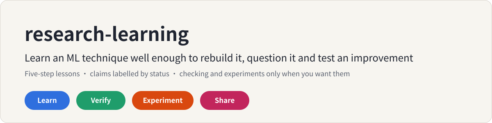
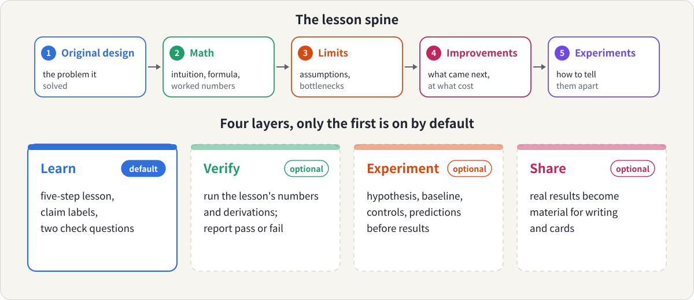
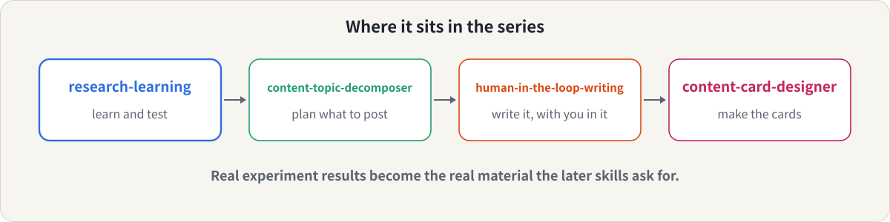

<p align="center">
  
</p>

<p align="center">
  <b>English</b> &nbsp;|&nbsp; <a href="README.zh-CN.md">简体中文</a>
  &nbsp;|&nbsp; <a href="LICENSE">MIT License</a>
</p>

A [Claude](https://claude.ai) skill for people who **learn machine-learning and LLM techniques** and want more than a summary: the ability to rebuild an idea, question its design, and test an improvement.

You ask about a technique. Claude teaches it as a research engineer would, says which of its claims are from a paper, derived, guessed or untested, and ends with questions that make you think. Checking the numbers and designing experiments are there when you want them, and only then.

## Is this for you?

- You want to understand **why** a design is the way it is (why divide by √d, why softmax saturates, why PPO clips), not just what it is.
- You've read an explanation and aren't sure which parts are established and which are the explainer's guess.
- You'd like to be able to **test** an idea: a controlled comparison, with a prediction written down first.
- You sometimes want only to learn, and don't want verification or experiments forced on you.
- You later want to write up what you learned or ran, using real results.

It is built for ML and LLM topics: concepts, architectures, training algorithms, systems optimization and papers. For other fields it still works but is less tuned.

## What you get

| Layer | When | What you get |
|---|---|---|
| **Learn** (default) | Any "help me learn X" | A lesson in five steps: original design, math, design limits, improvements, experiments. Intuition before formulas, a worked example with numbers, a table of key claims with their status, and two questions (one on the principle, one research question). |
| **Verify** (optional) | You ask, or say yes to its one-line offer | The lesson's numbers and derivations run as small checks, reported as pass or fail, plus what can't be verified by code. |
| **Experiment** (optional) | You want to test an idea | Hypothesis, baseline, one changed variable, controls, metrics, predicted outcomes, failure criteria. It asks for your prediction first. |
| **Share** (optional) | You want to write about it | Your real results and notes turned into material for writing and cards. |

Depth: **Quick**, **Standard** (default) and **Deep** (one step per round).

What it won't do: pretend to be an oracle, cite papers it hasn't seen, or turn a plan into a result.

## The idea in 30 seconds

Every technique has a design that answered a problem, a reason it works, a condition where it fails, and a line of later work. The skill walks that line, so you learn to reconstruct the idea instead of memorizing its name.

<p align="center">
  
</p>

Each key claim gets a status, so you know how much to trust it:

| Status | Meaning |
|---|---|
| Paper | Stated by a source it was given or fetched |
| Derived | Follows from the math shown, under stated assumptions |
| Checked | Run in code in this session (only after you asked for verification) |
| Conjecture | Plausible, not shown |
| Untested | A question an experiment could answer |

If it recalls a paper it hasn't opened, it says "from memory, not checked" instead of inventing a precise reference.

## See it work

Three real outputs, all in Chinese, with the body unedited:

| Request | Mode | Output |
|---|---|---|
| 「系统学一下 Attention 里的 softmax：为什么会饱和，为什么除以 √d」 | Learn | [examples/learn/response.md](examples/learn/response.md) |
| 「帮我验证一下上面这段讲解里的数值和公式对不对」 (an excerpt with two planted errors) | Verify | [examples/verify/](examples/verify/) |
| 「loss mask 会不会影响 SFT 结果？设计一个实验，我只有一台没有 GPU 的笔记本」 | Experiment | [examples/experiment/](examples/experiment/) |

What the verify example found in the planted excerpt: a table value that should be 0.0099 and not 0.009, and an experiment whose two variants give identical scores, so it could not tell them apart. Both were caught by running the numbers.

The experiment example asks you to write your prediction first, notices that "mask or not" also changes the loss normalization (a confounder), replaces the on/off switch with a dial, runs a small toy on a CPU, and states that no arm converged, so the toy shows slower learning, not a worse end result.

## Where it fits in the series

<p align="center">
  
</p>

Real experiment results are the real material the writing skills keep asking for. An experiment report from this skill has a "For writing" section that feeds [content-topic-decomposer](https://github.com/meiluosi/content-topic-decomposer); your notes feed [human-in-the-loop-writing](https://github.com/meiluosi/human-in-the-loop-writing); numbers you produced can go onto cards with [content-card-designer](https://github.com/meiluosi/content-card-designer). Each step is optional.

## The helper script

`scripts/claimcheck.py` is a tiny standard-library helper for verify mode. You write a few lines stating each claim next to the value your code computes, and it prints a pass or fail table and exits with an error if anything fails.

```python
from claimcheck import Checks, softmax
c = Checks("Softmax saturation")
p = softmax([10.0, 20.0, 30.0])
c.approx("weight on the largest score", got=p[2], expected=0.999955, tol=1e-6)
c.grad("d(x^2)/dx", f=lambda x: x[0] ** 2, x=[3.0], analytic=[6.0])
raise SystemExit(c.report())
```

## Install

**Claude Code** (personal skill):

```bash
git clone https://github.com/meiluosi/research-learning.git
cp -r research-learning/skills/research-learning ~/.claude/skills/
```

**Claude.ai / Claude desktop:** zip the `skills/research-learning` folder (so that `SKILL.md` sits inside it) and upload it under Settings → Capabilities → Skills.

Learn mode needs nothing else. Verify mode needs Python 3 (numpy helps). Run the helper's tests with `python3 -m unittest test_claimcheck` inside `scripts/`.

## Use

- "Help me learn why softmax attention saturates and why we divide by √d."
- "帮我讲讲 PPO 的 clip 为什么这样设计。"
- "Walk me through this paper's evidence, not just its abstract."
- "Check the numbers in that lesson by running them."
- "Design an experiment to test whether a learned temperature helps. I have a laptop."

Claude picks the skill from what you ask. If it doesn't trigger, name it: in Claude Code type `/research-learning`, or say "use the research-learning skill" in Claude.ai.

## How well does it work?

Honest answer: small tests, mostly on one topic, and plain Claude is already strong here.

Three tasks (a lesson on softmax saturation, verifying an excerpt, designing a loss-mask experiment) were run with and without the skill. On a checklist of 25 items about structure and honesty, the first version of the skill passed 24 and plain Claude 19. After one round of tightening, the lesson task passed all 10 of its items.

What the numbers hide:

- **Plain Claude was good at the substance.** Its lessons were correct, ran their own numpy experiments, flagged unchecked citations, and caught both planted errors when asked to verify. The skill's advantage is structure and restraint: a per-claim status table, a principle question plus a research question, a prediction before the result, a list of what couldn't be verified, and one offer instead of unrequested extras.
- **The first version did too much.** Its lesson ran a 14-check script and labelled results "checked" without being asked, against the design. The rule was tightened (no code and no "checked" labels in Learn mode unless you ask), and a re-run followed it. Plain Claude also ran its own experiments unasked.
- **The checklist was written after seeing outputs and the tightening was made in response**, so the final 10 of 10 is not an independent test.
- **I can check numbers, not understanding.** The verify mode catches arithmetic and derivation slips. Whether an explanation is conceptually right needs a reader who knows the field; the lessons here were reviewed only for numbers.
- **One topic, a handful of runs.** Other topics, and English-language lessons, were not tested.
- **The trigger rate was not measured.**

Issues and corrections from people who know these topics are very welcome.

## What's inside

```
skills/research-learning/
├── SKILL.md                         # principles, modes, the five-step lesson
├── references/
│   ├── learning-framework.md        # routing by object, step variants, depth and length budget
│   ├── claim-status.md              # the five statuses and how to use them
│   ├── math-explanation.md          # intuition, example, formula; derivations and gradients
│   ├── comprehension-checks.md      # the two questions; responding to answers; predict first
│   ├── verification.md              # verify mode
│   ├── experiment-design.md         # experiment mode
│   └── handoff.md                   # share mode: from results to writing
├── assets/templates/                # concept note, paper note, experiment plan and report, claims ledger
└── scripts/
    ├── claimcheck.py                # pass or fail table for claims (standard library only)
    └── test_claimcheck.py           # python3 -m unittest
examples/                            # learn, verify, experiment
assets/                              # diagrams used in this README
```

## Credit

- The idea of learning a technique by following its lineage from original design to experiments, and of separating "stated", "derived" and "untested", was developed in a working session and adapted from a proposal for a research-engineering learning skill.
- Ideas from existing open-source projects, taken as ideas only and not copied: [scientific-research-skills](https://github.com/jxtse/scientific-research-skills) (several small skills instead of one large one), [how-to-read-paper-skill](https://github.com/UAACC/how-to-read-paper-skill) (read to a depth that matches the paper's importance), [claude-academic-skill](https://github.com/eatdolronbeen-dot/claude-academic-skill) (checking that the learner understood), [paper-reading-skill](https://github.com/xiaofengShi/paper-reading-skill) (optional visual material, not adopted here). I read their READMEs and file lists and did not audit or run their code.

## License

[MIT](LICENSE)
