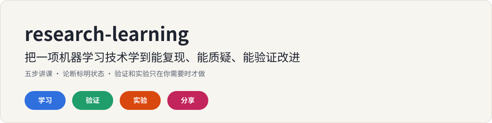
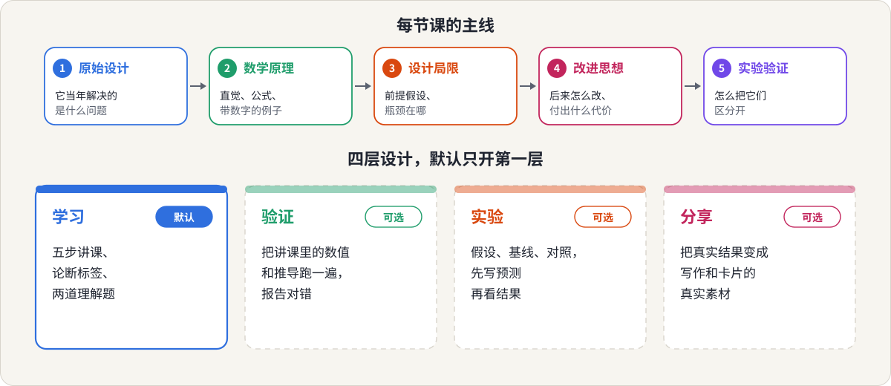

<p align="center">
  
</p>

<p align="center">
  <a href="README.md">English</a> &nbsp;|&nbsp; <b>简体中文</b>
  &nbsp;|&nbsp; <a href="LICENSE">MIT 许可</a>
</p>

一个 [Claude](https://claude.ai) skill，写给**学习机器学习和大模型技术**、又不满足于只看总结的人：你想要的是能复现一个想法、质疑它的设计、并验证一项改进的能力。

你问一项技术，Claude 像研究工程师那样把它讲清楚，并标明每个关键论断是论文说的、推导出来的、猜测的，还是还没验证的，最后留下几个让你思考的问题。验证数值和设计实验都有，但只在你需要时才做。

## 这是写给你的吗？

- 你想弄清一个设计**为什么**是这样（为什么除以 √d、softmax 为什么会饱和、PPO 为什么要截断），而不只是它是什么。
- 你读过一份讲解，但分不清哪些是公认的、哪些是讲的人自己的猜测。
- 你希望能**验证**一个想法：做一个对照实验，并且先把预测写下来。
- 你有时只想学点东西，不想被验证或实验打扰。
- 之后你想把学到的或做过的写出来，而且用的是真实结果。

它是为机器学习和大模型主题设计的：概念、架构、训练算法、系统优化和论文。其他领域也能用，但没有专门调过。

## 你会得到什么

| 层 | 什么时候 | 你得到什么 |
|---|---|---|
| **学习**（默认） | 任何"帮我学 X" | 一节五步的课：原始设计、数学原理、设计局限、改进、实验。先讲直觉再讲公式，带数字的例子，关键论断及其状态的表格，以及两道题（一道原理题、一道研究题）。 |
| **验证**（可选） | 你提出，或同意它的一句话提议 | 把讲课里的数值和推导跑成小检查，报告通过或失败，并说明哪些没法用代码验证。 |
| **实验**（可选） | 你想验证一个想法 | 假设、基线、单一变量、对照、指标、预期结果、失败判据。它会先请你写下预测。 |
| **分享**（可选） | 你想把它写出来 | 把你的真实结果和笔记变成写作和卡片的素材。 |

深度：**Quick**、**Standard**（默认）、**Deep**（每轮只推进一步）。

它不会做的事：假装是权威、引用没看过的论文，或者把计划当成结果。

## 30 秒讲清思路

每项技术都有一个当年要解决的问题、它有效的原因、失效的条件，以及后续的改进。这个 skill 沿着这条线讲，让你学会重建一个想法，而不是背一个名字。

<p align="center">
  
</p>

每个关键论断都有状态，让你知道该信几分：

| 状态 | 含义 |
|---|---|
| 论文 | 来自它拿到或取回的来源 |
| 推导 | 由所展示的数学在明确假设下得出 |
| 已验证 | 在本次会话里用代码跑过（只在你要求验证之后才用） |
| 推测 | 合理但没有展示 |
| 未检验 | 实验可以回答的问题 |

如果它记得一篇论文但没有打开过，会写"凭记忆，未核对"，而不是编一个精确的引用。

## 看它怎么工作

三份真实输出，正文未改动：

| 请求 | 模式 | 输出 |
|---|---|---|
| 「系统学一下 Attention 里的 softmax：为什么会饱和，为什么除以 √d」 | 学习 | [examples/learn/response.md](examples/learn/response.md) |
| 「帮我验证一下上面这段讲解里的数值和公式对不对」（讲解里埋了两处错误） | 验证 | [examples/verify/](examples/verify/) |
| 「loss mask 会不会影响 SFT 结果？设计一个实验，我只有一台没有 GPU 的笔记本」 | 实验 | [examples/experiment/](examples/experiment/) |

验证示例在埋了错的讲解里找到了：一处表格数值应该是 0.0099 而不是 0.009，以及一个实验设计里两个方案其实给出完全相同的分数，所以根本区分不了。这两处都是靠把数字跑一遍发现的。

实验示例先请你写预测，指出"是否 mask"其实还改变了 loss 的归一化（一个混淆变量），把开关改成了剂量曲线，在 CPU 上跑了一个小玩具实验，并说明没有任何一组收敛，所以玩具实验只能说明学得慢，不能说明最终结果更差。

## 它在系列里的位置

<p align="center">
  
</p>

真实的实验结果，就是后面几个写作 skill 一直要求的真实素材。这个 skill 产出的实验报告里有"用于写作"的部分，可以喂给 [content-topic-decomposer](https://github.com/meiluosi/content-topic-decomposer)；你的笔记可以喂给 [human-in-the-loop-writing](https://github.com/meiluosi/human-in-the-loop-writing)；你自己跑出的数字可以用 [content-card-designer](https://github.com/meiluosi/content-card-designer) 做成卡片。每一步都是可选的。

## 辅助脚本

`scripts/claimcheck.py` 是验证模式用的一个很小的标准库工具。你写几行，把每个论断和代码算出的值放在一起，它打印通过或失败的表格，有失败时以错误码退出。

```python
from claimcheck import Checks, softmax
c = Checks("Softmax saturation")
p = softmax([10.0, 20.0, 30.0])
c.approx("weight on the largest score", got=p[2], expected=0.999955, tol=1e-6)
c.grad("d(x^2)/dx", f=lambda x: x[0] ** 2, x=[3.0], analytic=[6.0])
raise SystemExit(c.report())
```

## 安装

**Claude Code**（个人 skill）：

```bash
git clone https://github.com/meiluosi/research-learning.git
cp -r research-learning/skills/research-learning ~/.claude/skills/
```

**Claude.ai / Claude 桌面端**：把 `skills/research-learning` 文件夹打成 zip（`SKILL.md` 在文件夹里面），在 设置 → 能力 → Skills 中上传。

学习模式不需要其他东西。验证模式需要 Python 3（有 numpy 更方便）。在 `scripts/` 里运行 `python3 -m unittest test_claimcheck` 可以跑辅助脚本的测试。

## 使用

- "帮我学一下 softmax attention 为什么会饱和，为什么要除以 √d。"
- "Help me understand why PPO clips the ratio."
- "带我读这篇论文的证据，不要只看摘要。"
- "把刚才那节课里的数字跑一遍核对一下。"
- "设计一个实验，看可学习温度有没有帮助，我只有一台笔记本。"

Claude 会根据你的需求自动调用。没有自动触发时可以点名：在 Claude Code 里输入 `/research-learning`，在 Claude.ai 里说"用 research-learning 这个 skill"。

## 效果如何？

诚实地说：只做过小规模测试，而且主要集中在一个主题上，普通 Claude 在这件事上本来就已经很强。

三个任务（一节关于 softmax 饱和的课、验证一段讲解、设计一个 loss mask 实验），各用有无 skill 跑一遍。用一份 25 项的清单评分（结构和诚实度），第一版 skill 通过 24 项，不带 skill 的 Claude 通过 19 项。收紧规则后，学习任务的 10 项全部通过。

数字没有说明的部分：

- **普通 Claude 在内容本身上做得很好。** 它的课讲得正确，自己跑了 numpy 实验，标注了没核对的引用，让它验证时也抓到了两处埋的错误。skill 的优势在结构和克制：逐条论断的状态表、一道原理题加一道研究题、先预测再看结果、单独列出没法验证的部分，以及"只提议一次"而不是不请自来的多余内容。
- **第一版做得太多。** 它的课没有被要求就跑了一个 14 项检查的脚本，并把结果标成"已验证"，与设计相悖。规则随后收紧（学习模式下，你不要求就不跑代码、不标"已验证"），重新跑的一次遵守了。不带 skill 的 Claude 同样会自己跑实验。
- **清单是看过输出之后写的，收紧也是针对它发现的问题做的**，所以最终的 10/10 不是独立测试。
- **我能检查数字，检查不了理解。** 验证模式能抓出算术和推导上的小错。一个解释在概念上对不对，需要懂这个领域的读者来判断；这里的课只核对过数字。
- **一个主题，几次运行。** 其他主题和英文课程没有测试。
- **触发率没有测量。**

欢迎熟悉这些主题的人提 issue 和指正。

## 目录

```
skills/research-learning/
├── SKILL.md                         # 原则、模式、五步讲课
├── references/
│   ├── learning-framework.md        # 按对象路由、各步骤变体、深度和篇幅预算
│   ├── claim-status.md              # 五种状态及其用法
│   ├── math-explanation.md          # 直觉、例子、公式；推导和梯度
│   ├── comprehension-checks.md      # 两道题；回应你的答案；先预测
│   ├── verification.md              # 验证模式
│   ├── experiment-design.md         # 实验模式
│   └── handoff.md                   # 分享模式：从结果到写作
├── assets/templates/                # 概念笔记、论文笔记、实验计划和报告、论断清单
└── scripts/
    ├── claimcheck.py                # 论断的通过/失败表（仅标准库）
    └── test_claimcheck.py           # python3 -m unittest
examples/                            # 学习、验证、实验
assets/                              # README 里用到的示意图
```

## 致谢

- "沿着从原始设计到实验的谱系学习一项技术，并区分'论文说的、推导的、未检验的'"这个思路，是在一次工作讨论中形成的，改编自一份关于研究工程学习 skill 的提案。
- 借鉴了几个现有开源项目的想法，只取思路，没有复制：[scientific-research-skills](https://github.com/jxtse/scientific-research-skills)（用几个小 skill 而不是一个大 skill）、[how-to-read-paper-skill](https://github.com/UAACC/how-to-read-paper-skill)（按论文的重要性决定读到多深）、[claude-academic-skill](https://github.com/eatdolronbeen-dot/claude-academic-skill)（检查学习者是否真的理解）、[paper-reading-skill](https://github.com/xiaofengShi/paper-reading-skill)（可选的可视化材料，这里没有采用）。我只读了它们的 README 和文件列表，没有审查或运行它们的代码。

## 许可

[MIT](LICENSE)
